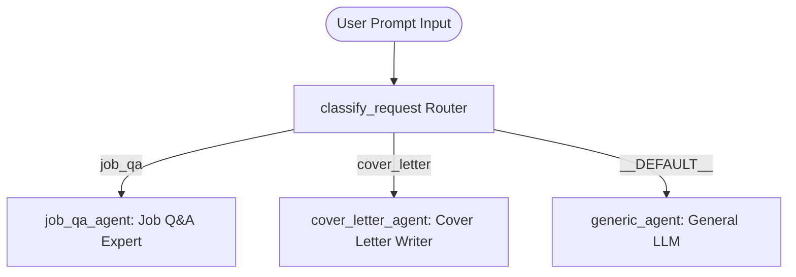

# Walkthrough: `job-app-agent` (ADK 2.0 Graph Workflow)

We have created and verified **`job-app-agent`**, a job application assistant built using **ADK 2.0 Graph Workflows** (`google.adk.workflow.Workflow`).

---

## 🏗️ Architecture & Component Overview

The project is located at:
`file:///home/robert/work/agents/projects/job-app/job-app-agent`

```
job-app-agent/
├── app/
│   ├── __init__.py           # Package exports
│   ├── agent.py              # ADK 2.0 Workflow graph & agent nodes
│   ├── context_utils.py      # Hooks for persistent user profile & skills
│   ├── fast_api_app.py       # FastAPI web server endpoint for mobile & web access
│   └── app_utils/            # A2A protocol & service handlers
├── .env                      # Local development & GCP project configuration
├── Dockerfile                # Container definition for Cloud Run / GKE deployment
├── GEMINI.md                 # Agent guidance rules
└── pyproject.toml            # ADK 2.0 dependencies & build configuration
```

---

## 🔀 ADK 2.0 Graph Workflow Topology

The core graph is defined in [`app/agent.py`](file:///home/robert/work/agents/projects/job-app/job-app-agent/app/agent.py):



1. **`classify_request` Node**: Analyzes incoming prompts and classifies them into `job_qa`, `cover_letter`, or `generic`.
2. **`job_qa_agent` Node**: Specialized `LlmAgent` providing tailored advice for interview questions, resume framing, and job application strategy.
3. **`cover_letter_agent` Node**: Specialized `LlmAgent` drafting professional, structured cover letters.
4. **`generic_agent` Node**: Fallback `LlmAgent` handling any non-job-application query.

---

## 🧠 Persistent User Context & Skills Integration

In [`app/context_utils.py`](file:///home/robert/work/agents/projects/job-app/job-app-agent/app/context_utils.py), we provided hooks to seamlessly inject your skills and persistent profile:

```python
# To pass persistent context at runtime, set keys in the ADK session state:
ctx.state["user_profile"] = {
    "full_name": "Jane Doe",
    "summary": "Senior Software Engineer with 7 years of cloud experience",
    "skills": ["Python", "ADK 2.0", "GCP", "Kubernetes"],
    "experience": [...]
}

ctx.state["user_skills"] = [
    {"name": "STAR Technique Answer Framing"},
    {"name": "Executive Cover Letter Styling"}
]
```

---

## 🧪 Verification & Test Results

All three graph execution branches were tested and verified against Google Vertex AI:

1. **Job Q&A Route**: Verified with *"How should I answer a question about my weaknesses in a job interview?"*
   - Successfully routed to `job_qa_agent`.
   - Delivered a 3-step structured formula (Weakness + Action + Growth) with concrete examples.

2. **Cover Letter Route**: Verified with *"Write a cover letter for a Software Engineer role at Google."*
   - Successfully routed to `cover_letter_agent`.
   - Generated a full, professional cover letter template with Google-tailored achievements.

3. **Generic Route**: Verified with *"What is the capital of France?"*
   - Successfully routed to `generic_agent`.
   - Output: `"The capital of France is Paris."`

---

## 📱 Querying from Web / Firefox Browser (Android Mobile)

### Running Locally on Your Local Network
To test or access the agent from a browser (including Firefox on an Android phone on your local Wi-Fi):

1. **Start the FastAPI Server**:
   ```bash
   cd job-app-agent
   uv run uvicorn app.fast_api_app:app --host 0.0.0.0 --port 8000
   ```
2. **Open Firefox on Android**:
   Navigate to `http://<your-computer-local-ip>:8000/docs` (Swagger UI) or query the OpenAPI endpoints.

---

## 🚀 Cloud Deployment Options

When ready to deploy to production:

```bash
cd job-app-agent
agents-cli scaffold enhance . --deployment-target cloud_run
agents-cli deploy
```

This will deploy your container to Google Cloud Run with a public HTTPS URL accessible from any mobile browser anywhere.
